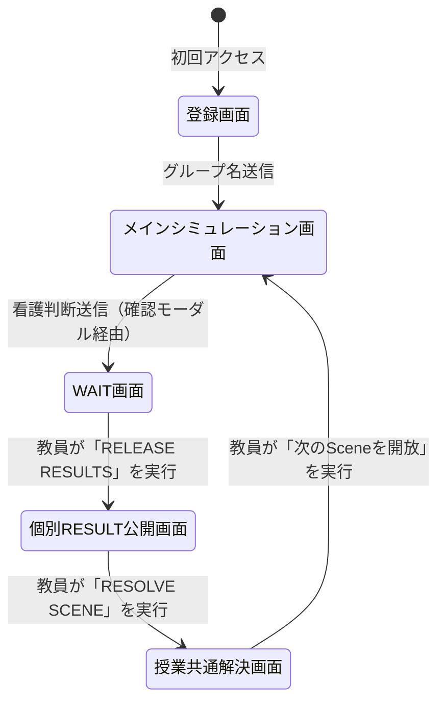
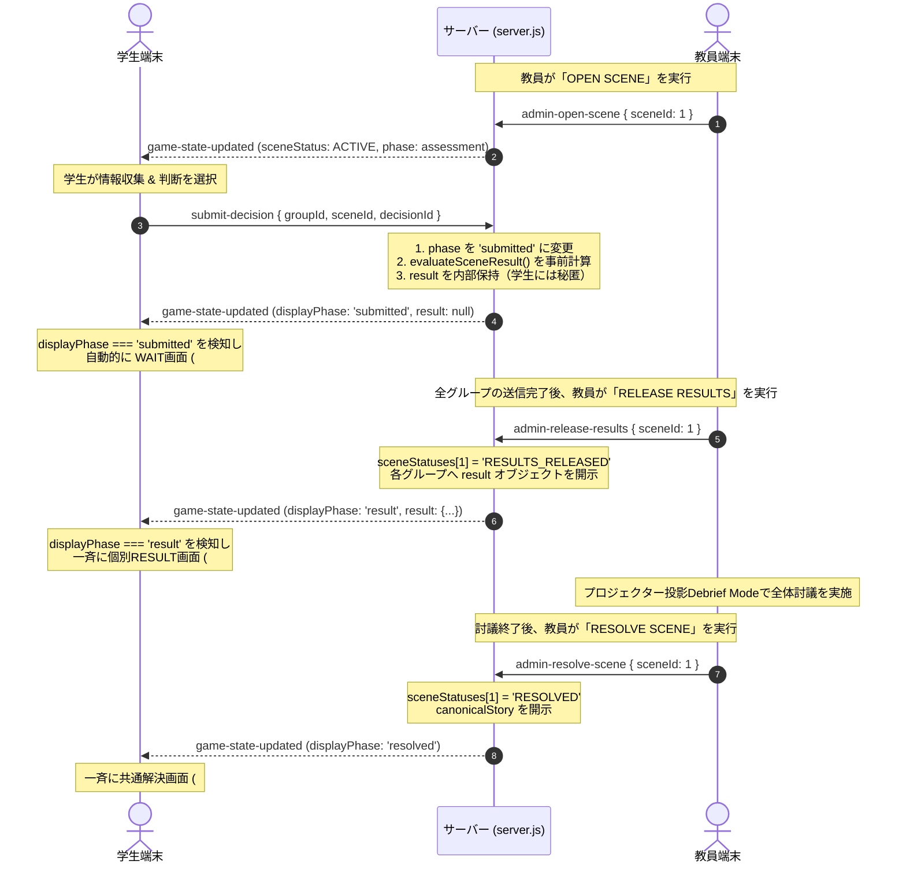

# Clinical Reasoning Simulation システム設計・技術仕様書
**対象：第3回「心臓リハビリテーション」実装解析 ＆ 第4回「肺がん患者の看護」展開設計書**

---

## 1. システム全体アーキテクチャ概要

本システムは、看護学教育における**グループ対話型・臨床推論シミュレーション（Clinical Reasoning Simulation）**を実現するWebアプリケーションです。  
教員端末（管理画面）と学生端末（スマートフォン・タブレット・PC）がリアルタイムに双方向同期し、授業の進行段階（6段階同期モデル）に合わせて画面と選択肢・結果が開示されます。

```
[ 学生端末（各グループ） ]  <-- WebSocket (Socket.IO) -->  [ Node.js / Express サーバー ]
       (index.html)                                               (server.js)
       (student.js)                                                    |
                                                                       +-- data/scenario.json (シナリオ定義)
                                                                       +-- インメモリ状態管理 (Map)
[ 教員端末（PC / プロジェクター） ] <-- WebSocket (Socket.IO) --------+
       (admin.html)
       (admin.js)
```

### 技術スタック
- **バックエンド**: Node.js, Express, Socket.IO (`^4.7.0`), `uuid`, `qrcode`
- **フロントエンド**: HTML5, Vanilla JavaScript（フレームワーク非依存）, Pure CSS3（`style.css` 1ファイル）
- **状態管理**: サーバー側完全集中インメモリ管理（Server-authoritative）、クライアント側 `localStorage` による再接続支援
- **通信プロトコル**: WebSocket / Socket.IO イベント駆動モデル

---

## 2. 既存アプリの画面構成と画面遷移

学生用画面（`public/index.html`）は**シングルページアプリケーション（SPA）**として構築されており、5つの独立した画面コンテナ（`.screen`）が定義されています。  
JavaScriptの `showScreen(screenId)` 関数により、対象の画面にのみ `.active` クラスを付与して排他表示されます。



### 各画面の構成詳細

#### ① 登録画面 (`#screen-register`)
- **役割**: グループ名の入力と、シミュレーション対象患者の初期提示。
- **構成要素**:
  - タイトル・サブタイトル（講義名・患者事例名）
  - グループ名入力フォーム（`#group-name`）＋開始ボタン（`#btn-register`）
  - 事例概要カード（`#patient-summary`）：患者の氏名、年齢、既往歴、現病歴、現在の状態を表示。

#### ② メインシミュレーション画面 (`#screen-game`)
- **役割**: 情報収集（アセスメント）および看護判断の選択・送信。
- **構成要素**:
  1. **ヘッダー**: 現在のSceneタイトル・サブタイトル、グループ名バッジ。
  2. **プログレスバー**: BEFORE → DURING → AFTER → NEXT の4段階進捗（`active`, `completed`）。
  3. **患者ビジュアル**: SVGアバター（安静 `resting`、歩行 `walking`、不快感 `discomfort`、休息 `resting-after`）。
  4. **患者発言ダイアログ**: 患者の発話（吹き出し）。
  5. **事前確認バイタルサインカード**: 初期提示情報（BP, HR, RR, SpO₂, BT, 意識レベルなど、**Budgetを消費せず全員に表示**）。
  6. **指示文ボックス**: 本Sceneで学生が考えるべき問いや指示。
  7. **（Scene 4のみ）日常生活動作とMETs表**: 退院後の活動要求度データ。
  8. **Information Budget表示**: ドットインジケーター（● ● ●）と「残り N つの情報を確認できます」テキスト。
  9. **情報選択肢カード一覧**: クリックで裏面（詳細内容）を開示するインタラクティブカード。
  10. **取得済み情報リスト**: すでに開示した情報を一覧で確認できる復習領域。
  11. **「看護判断へ進む」ボタン**: 1つ以上の情報取得またはBudget消費後に表示。
  12. **看護判断セクション**: A〜Dの4択ラジオカード ＋ 送信ボタン。
  13. **送信確認モーダル (`#confirm-modal`)**: 誤送信防止の確認ダイアログ。

#### ③ WAIT画面 (`#screen-wait`)
- **役割**: 判断送信完了後、全グループが揃い教員が結果を公開するまでの待機画面。
- **構成要素**:
  - 砂時計アイコン、パルスアニメーション。
  - 「他のグループも検討しています。教員が結果を公開するまで、この画面でお待ちください。」という案内文。

#### ④ 個別RESULT公開画面 (`#screen-result` / Student Branch)
- **役割**: 各グループが「何を確認し、どう判断したか」に応じた個別の患者経過・フィードバックの提示。
- **構成要素**:
  - **YOUR ACTION**: 当該グループが選択した判断ラベル。
  - **YOUR ASSESSMENT**: シミュレーション重要項目のうち、「確認した情報（✓）」と「未確認の情報（―）」の対比グリッド。
  - **PATIENT RESPONSE**:
    - Patient Outcomeバッジ（`STABLE`, `CONDITION_CHANGED`, `DETERIORATED`）。
    - 結果タイトル。
    - ノベル形式の患者経過ストーリー（選択した根拠に基づく動的解説文）。
  - **REFLECTION QUESTION**: グループ討議用の振り返りの問い。
  - 全体討議待ち案内バー。

#### ⑤ 授業共通解決画面 (`#screen-canonical` / Canonical Story)
- **役割**: 個別分岐で多様な経過を体験した学生全員を、授業上の正式な患者経過へ合流させる画面。
- **構成要素**:
  - CLINICAL RESOLUTION バッジ。
  - 公式解決ストーリー（Canonical Story全文）。
  - 核となる指導メッセージ（例:「『回復したこと』と『次の活動を安全に行えること』は別の判断である」）。
  - 次のSceneへの接続文 ＋ 次Scene開放待ち表示。

---

## 3. Sceneの進行・回答確定・WAIT画面の仕組み

授業進行の同期統制は、サーバー側で管理される `sceneStatuses`（Sceneごとの状態）と、各グループの `groupState.scenes[sid].phase` の組み合わせによって実現されています。

### サーバー側のScene状態（`sceneStatuses[sid]`）
- `LOCKED`: ロック中（学生端末はアクセス不可）
- `ACTIVE`: 開放中（学生が情報収集・判断入力中）
- `RESULTS_RELEASED`: 個別結果公開中（学生端末は一斉に `#screen-result` へ遷移）
- `RESOLVED`: 解決済み（学生端末は一斉に `#screen-canonical` へ遷移）

### 各グループの内部フェーズ（`groupState.scenes[sid].phase`）
- `'assessment'`: 情報収集中・判断検討中
- `'submitted'`: 判断送信済み（WAIT画面表示）

### 回答確定・WAIT画面・結果公開の通信フロー



---

## 4. Information Budgetのデータ構造と制御方法

### データ定義構造（`data/scenario.json`）
各Sceneに閲覧可能上限（`budget`）と、選択肢配列（`infoItems`）が定義されています。

```json
{
  "scenes": {
    "1": {
      "budget": 3,
      "infoItems": [
        {
          "id": "symptoms",
          "label": "現在の胸部症状・随伴症状",
          "icon": "🫀",
          "domains": ["Symptoms", "Ischemia"],
          "isCritical": true,
          "content": "胸痛・前胸部圧迫感：なし。\n冷汗・嘔気・めまいなし..."
        },
        {
          "id": "ecg",
          "label": "12誘導心電図・モニター心電図の経過",
          "icon": "📈",
          "domains": ["Ischemia", "Rhythm"],
          "isCritical": true,
          "content": "洞調律（HR 68 bpm）。新たなST変化なし..."
        }
      ]
    }
  }
}
```

### サーバー側の状態データ構造（`server.js`）
```javascript
{
  budget: 3,             // 初期付与Budget数
  remainingBudget: 3,    // 残りBudget数（消費ごとに -1）
  selectedInfo: []       // 選択された infoId の配列（例: ['symptoms', 'ecg']）
}
```

### 4重バリデーション（サーバーサイド制御）
学生端末から `select-info` イベントが送信された際、サーバーは以下の4条件を厳格に検証します。
```javascript
// 1. Sceneが現在開放中か
if (sceneStatuses[sid] !== 'ACTIVE') return error;

// 2. まだ回答送信前（assessmentフェーズ）か
if (sceneState.phase !== 'assessment') return error;

// 3. 残りBudgetが残っているか
if (sceneState.remainingBudget <= 0) return error;

// 4. すでに選択済みの情報ではないか（重複防止）
if (sceneState.selectedInfo.includes(infoId)) return error;

// 検証通過
sceneState.selectedInfo.push(infoId);
sceneState.remainingBudget -= 1;
```

### クライアント側のUI表現
1. **ドット表示**: 合計Budget数分の丸を描画し、消費されたドットはグレーアウト（`.used`）。
2. **カードの無効化**: `remainingBudget === 0` になると、未選択のカードすべてに `.disabled` クラスが付与され、マウスポインタとクリックが無効化されます。
3. **判断への誘導**: Budgetが0になった瞬間、または1つ以上選択した段階で「看護判断へ進む」ボタンが表示され、判断入力欄へスクロール誘導します。

---

## 5. 学生の回答・結果の保存方法

### サーバー側インメモリ保存構造（`groups: Map<string, GroupState>`）
```javascript
{
  groupId: "uuid-v4-string",
  groupName: "グループ1",
  currentScene: 1,
  registeredAt: "2026-10-21T03:00:00.000Z",
  scenes: {
    "1": {
      sceneId: 1,
      phase: "submitted",
      selectedInfo: ["symptoms", "ecg", "respiratory_congestion"],
      budget: 3,
      remainingBudget: 0,
      decision: "start-normal",
      submittedAt: "2026-10-21T03:05:22.000Z",
      result: {
        patientOutcome: "STABLE",
        clinicalReasoning: "SUFFICIENT_ASSESSMENT",
        resultType: "Well-supported safe decision",
        title: "安全な活動開始（シミュレーション重要3領域の確実な評価）",
        story: "あなたたちは活動開始前に3領域の情報を確実にアセスメントした上で...",
        reflectionQuestion: "活動開始前に確認した3つの情報が..."
      }
    },
    "2": { ... },
    "3": { ... },
    "4": { ... }
  }
}
```

### 再接続（Reconnection）と永続化の仕組み
- 学生端末の `localStorage` に `crs_group_id` と `crs_group_name` を保存。
- 学生がブラウザをリロードした場合、またはWi-Fiが一時切断して再接続した際、Socket.IO の `connect` イベントで `rejoin-group` を自動送信。
- サーバーは既存の `groupState` を探索してルームに再結合（`socket.join('group_' + groupId)`) し、直近の完全な状態を返送（`rejoined`）するため、**作業途中の状態が完全に復元**されます。

### サニタイズ配信（カンニング防止機構）
`buildClientPayload(groupState)` 関数により、教員が `RESULTS_RELEASED` を実行するまで、学生端末に送られるJSON内の `result` は強制的に `null` に置換されます。  
ブラウザの開発者ツール等でネットワーク通信を解析しても、教員の合図より前に正答や結果を知ることはできません。

---

## 6. 教員用管理画面と進行管理機能

教員用管理画面（`public/admin.html`, `public/js/admin.js`）は、授業中のファシリテーションを円滑に行うための3つのタブと、プロジェクター専用ビューを備えています。

### ① Scene進行制御タブ (`tab-control`)
- **学生端末アクセス案内**: 接続先URL（PCローカルまたは公開URL）および**動的生成QRコード**の表示。
- **Scene別カード（1〜4）**:
  - 現在の回答送信状況（例: `5 / 8 グループ送信済み`）。
  - **進行制御ボタン**:
    - `▶ OPEN SCENE`（Sceneの開放）
    - `📢 RELEASE RESULTS`（個別結果の一斉公開）
    - `✅ RESOLVE SCENE`（全員公式経過へ合流）
    - `⏩ OPEN NEXT SCENE`（次のSceneへ一括移行）
  - 各操作には誤操作防止のモーダル確認ダイアログが付属。

### ② グループ進行一覧タブ (`tab-groups`)
全グループのリアルタイムモニタリングテーブル。
- 列項目：グループ名、現在のScene、進行状態（収集中/送信済み）、Budget使用状況、選択した情報名一覧、最終判断、Patient Outcome（安定/変化/悪化）、Clinical Reasoning分類。

### ③ 回答・評価集計タブ (`tab-summary`)
Sceneごとの回答傾向のリアルタイムグラフ化。
- **情報選択率（%）**: どの情報が多く選ばれ、どの重要情報が見落とされたか。
- **最終判断の分布（%）**: A〜Dの選択比率。
- **Patient Outcomeの分布（%）**: 安定、状態変化、悪化の比率。
- **指導の着眼点 ＆ 全体討議での発問例（Debrief Questions）**: 教員が討議をリードするための問いを表示。

### ④ プロジェクター投影用 Debrief Mode (`#admin-debrief`)
- 教室の大画面スクリーンに投影するための全画面ハイコントラスト画面。
- **グループ名や個別スコアを非表示にした匿名集計グラフ**を表示。
- クラス全体の思考の偏りや見落としを可視化し、安全な心理的環境で討議を活性化。

### ⑤ 全データ初期化（Reset All）
- 演習終了時やリハーサル後に全グループデータを破棄し、全学生端末を登録画面へ一括強制リセットするボタン。

---

## 7. 自由記述回答フェーズの追加実装設計（第4回版の要件）

第4回「肺がん患者の看護」では、学生が**アセスメント理由（観察した根拠・病態生理・看護方針）を文章で記述できるフェーズ**を導入します。

### 推奨されるUI/UX設計（2ステップ統合型）
判断選択肢（A〜D）を選ぶセクション内に、**「判断の根拠とアセスメント理由」の入力エリア**を組み込む方式を推奨します。

```
[ 看護判断セクション ]
  A．〜〜〜〜
  B．〜〜〜〜
  C．〜〜〜〜
  D．〜〜〜〜

[ アセスメント理由の記述（必須） ]
  なぜこの判断を選びましたか？
  患者のどの情報に注目し、どのような病態・リスクをアセスメントしたか記述してください：
  +-------------------------------------------------------+
  | （自由記述テキストエリア：最小30文字〜最大400文字）    |
  +-------------------------------------------------------+
  [ この判断とアセスメントを送信する ]
```

### 実装手順の青写真

#### 1. データ定義（`data/scenario.json`）
各Sceneに記述の設問文と文字数制約を定義：
```json
{
  "scenes": {
    "1": {
      "rationalePrompt": "選択した判断の根拠について、患者の呼吸状態・画像所見・随伴症状から考えられる病態とリスクを含めて記述してください。",
      "rationaleMinLength": 30,
      "rationaleMaxLength": 400
    }
  }
}
```

#### 2. フロントエンド（`public/index.html` & `public/js/student.js`）
- `index.html` の `#decision-section` に `<textarea id="student-rationale">` と文字数カウンタを追加。
- 送信ボタンは「判断の選択」かつ「記述文字数 >= 30」で活性化。
- 送信確認モーダル（`#confirm-modal`）内に、選択した判断とともに記述した文章のプレビューを表示。
- 送信イベント:
  ```javascript
  socket.emit('submit-decision', {
    groupId,
    sceneId: payload.currentScene,
    decisionId: selectedDecisionId,
    rationaleText: document.getElementById('student-rationale').value.trim()
  });
  ```
- 結果画面（`#screen-result`）: `YOUR ACTION` の隣に「あなたたちの記述したアセスメント根拠」を表示。

#### 3. サーバー側（`server.js`）
- `groupState.scenes[sid]` に `rationaleText: string` を保持。
- `buildAdminSummary()` に `rationaleText` を含め、教員管理画面へ渡す。

#### 4. 教員管理画面（`public/admin.html` & `public/js/admin.js`）
- **グループ一覧タブ**: テーブルに「記述アセスメント」列を追加し、ボタンクリックで全文を閲覧可能にする。
- **Debrief Mode**: 「学生のアセスメント記述ピックアップ」領域を新設。教員が良い視点や典型的な誤解を含む記述を画面上で引用・共有してクラス討議を発展させられるようにする。

---

## 8. 第3回アプリを変更せず、第4回版を独立して作成するための方法

第3回「急性心筋梗塞後の心臓リハビリテーション」は本番授業を控えており、既存のコード、Git履歴、Render本番URLを100%保護する必要があります。

### 推奨分離方針：完全独立ディレクトリ＆独立リポジトリ方式

```
/Users/shuheiyamada/.gemini/antigravity/scratch/
  ├── cardiac-rehab-sim/          <-- 【第3回・既存環境】絶対に手を加えない
  │     ├── data/scenario.json    （心リハ症例・判定ロジック）
  │     └── git: Cardiac_Simulation.git (Render連携中)
  │
  └── lung-cancer-sim/            <-- 【第4回・新規作成ディレクトリ】
        ├── package.json          （独立したnpm環境）
        ├── server.js             （肺がん症例判定ロジック・自由記述受付）
        ├── data/scenario.json    （肺がん症例・呼吸器アセスメント）
        ├── public/               （自由記述UI追加）
        └── git: 新規リポジトリ     （Renderで新規Webサービスとしてデプロイ）
```

### 独立作成の手順
1. **プロジェクトのクローン/コピー**:
   `cardiac-rehab-sim` のディレクトリ全体を新しいディレクトリ（例: `lung-cancer-sim`）へ複製。
2. **Git管理の初期化**:
   新しいディレクトリ内の `.git` を初期化（`rm -rf .git && git init`）し、第3回のリポジトリから完全に切り離す。
3. **シナリオ・ロジックの差し替え**:
   - `data/scenario.json` を肺がん患者事例（術前呼吸機能、術後合併症アセスメント、呼吸リハ・排痰など）へ刷新。
   - `server.js` の `evaluateSceneResult()` を呼吸不全・無気肺・皮下気腫・出血等の呼吸器看護判定ロジックへ刷新。
   - 自由記述用パラメータの受け渡しを追加。
4. **新規GitHubリポジトリの作成とデプロイ**:
   GitHub上で `Lung_Cancer_Simulation` 等のリポジトリを新設し、Render.com で別の無料Webサービスとして登録することで、第3回とは独立した永続URLを取得。

---

## 9. 開発セッションに関する提案（既存セッション vs 新規セッション）

第4回版の開発を進めるにあたり、**「新規セッション（New Session）」で開発を開始することを強く推奨**いたします。

| 比較項目 | 既存セッションの継続 | 新規セッションの開始（★推奨） |
|---|---|---|
| **第3回への安全性** | △ 誤って既存リポジトリへコミット・プッシュするリスクがある | ◎ 物理的に別ディレクトリ・別コンテキストとなり干渉ゼロ |
| **AIの推論精度** | △ トークン履歴が長大化しており要約（Truncation）による細部喪失のリスクがある | ◎ コンテキストが100%クリーンで、症例設計や医学推論に全キャパシティを使用可能 |
| **第3回トラブル対応** | △ 履歴が混ざり、来週の心リハ授業直前の修正対応が困難になる | ◎ 本セッションを残しておけば、心リハの修正が必要な際に即座に戻れる |
| **Git・デプロイ分離** | △ カレントブランチやリモートURLの切り替え事故のリスク | ◎ 新規リポジトリ作成からRender連携まで明快に自動化可能 |

### 推奨する移行フロー
1. 本セッションにて、この仕様書をプロジェクト内（`docs/clinical-reasoning-simulation-system-spec.md`）に確実にコミット・保存して終了。
2. 新しいチャット画面（New Session）を開き、本仕様書を参照しながら「第4回 肺がん患者の看護」の開発を開始する。
